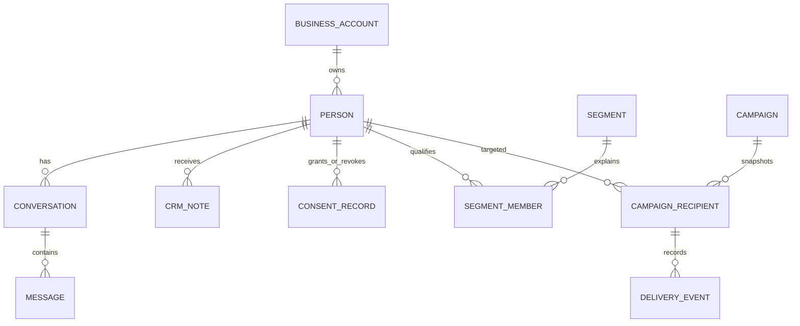
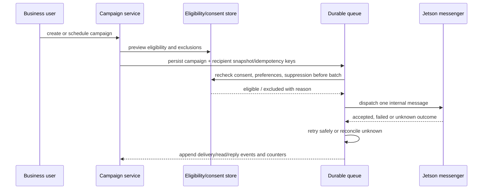

# CRM, Consent-Aware Campaigns and Analytics Research

**Review date:** 2026-11-23
**Scope:** source-level comparison of four independent references. No project is selected or adopted.

## Evidence and revisions

| Project | Pinned revision | Evidence inspected | License boundary |
|---|---|---|---|
| Chatwoot | `576e4f88cd3e5e312ce8fff73b04643e44726ffd` | `app/models/contact.rb`, `conversation.rb`, `note.rb`, `inbox.rb`, `contact_inbox.rb`, `label.rb`, `custom_filter.rb`, `spec/models/contact_spec.rb`, `spec/models/note_spec.rb` | Root `LICENSE`: MIT outside `enterprise/`; enterprise has separate terms. |
| Twenty | `8218d05450b1329e439136d8d3ef99ea0547dfc4` | `packages/twenty-server/src/engine/twenty-orm/workspace-scoped-repository/*`, `packages/twenty-server/src/engine/permissions/{record-permissions-read.service.ts,role/*,private-record/*,channel-visibility/*}`, related `__tests__` | Root `LICENSE`: AGPLv3 with commercial-marked files and MIT package exceptions. |
| Listmonk | `47a24dfe8a889b0c7fe8730b0bb7ac24ab571e87` | `models/subscribers.go`, `models/campaigns.go`, `models/lists.go`, `queries/{subscribers.sql,campaigns.sql,bounces.sql}`, `tests/specs/campaigns.spec.js`, `tests/specs/subscribers.spec.js` | Root `LICENSE`: AGPLv3. Email-specific implementation. |
| Mautic | `838c9c772ec7813d31bd135d22668481e644dcc7` | `app/bundles/{LeadBundle,CampaignBundle,SegmentBundle,UserBundle}/Entity`, `Model`, `Security/Permissions`, campaign functional/security tests | Root license and plugin notices must be reviewed with each bundle/dependency before reuse; copyleft/commercial operational implications remain material. |

Permalinks use the pinned revisions: [Chatwoot Contact](https://github.com/chatwoot/chatwoot/blob/576e4f88cd3e5e312ce8fff73b04643e44726ffd/app/models/contact.rb), [Chatwoot Conversation](https://github.com/chatwoot/chatwoot/blob/576e4f88cd3e5e312ce8fff73b04643e44726ffd/app/models/conversation.rb), [Twenty workspace repository](https://github.com/twentyhq/twenty/tree/8218d05450b1329e439136d8d3ef99ea0547dfc4/packages/twenty-server/src/engine/permissions), [Listmonk campaign selection](https://github.com/knadh/listmonk/blob/47a24dfe8a889b0c7fe8730b0bb7ac24ab571e87/queries/campaigns.sql), [Listmonk subscribers](https://github.com/knadh/listmonk/blob/47a24dfe8a889b0c7fe8730b0bb7ac24ab571e87/models/subscribers.go), and [Mautic Campaign bundle](https://github.com/mautic/mautic/tree/838c9c772ec7813d31bd135d22668481e644dcc7/app/bundles/CampaignBundle).

## Capability comparison

| Capability | Chatwoot | Twenty | Listmonk (email-specific) | Mautic | Jetson implication |
|---|---|---|---|---|---|
| Person/contact identity | Account-scoped `Contact`, unique email/identifier/phone, visitor/lead/customer enum | Workspace-scoped configurable objects and relations; standard people/companies | Subscriber UUID/email/name plus JSON attributes | Lead entity, fields, companies and tags | Keep a canonical Jetson person plus business-owned CRM projection; define merge/identity rules. |
| Conversation linkage | `Contact has_many conversations`; `Conversation belongs_to contact, inbox, contact_inbox, account` | Timeline/messaging objects and workspace ORM; inspect exact messaging adapters before reuse | None; campaign recipient is subscriber/list | Campaign events attach to leads; not a messenger conversation model | CRM history must link messages to the same Jetson identity, without treating campaign delivery as a conversation reply. |
| Notes/status/activity | Contact notes with account/contact/user ownership; conversation status, priority, assignee, labels, reporting events | Activities/timeline and extensible object metadata; row/field permissions | Subscriber activity stores views/clicks; campaign counters and timestamps | Notes, lead event logs, campaign event logs, scoring | Stage 2 needs notes, status, explainable segment membership and append-only activity events. |
| Segmentation | Labels and custom filters; automation boundaries | Filterable custom objects and workflows, permission-aware | Lists, tags, SQL query filters | Dynamic segments, filters, campaign triggers and scoring | Start with explicit segment rules and snapshot/explainability; defer arbitrary workflow graphs. |
| Consent/preferences | Contact `blocked` exists, but inspected models do not establish marketing consent semantics | Permission system is business-user access, not recipient consent | Single/double opt-in, per-list subscription state, unsubscribe and global blocklist | Lead channel preferences and do-not-contact model; campaign checks require broader audit | Consent evidence, category preferences, unsubscribe and suppression are first-class Jetson records, not inferred from CRM labels. |
| Eligibility timing | Campaign services exist, but this review did not verify complete consent recheck | Not a campaign sender | SQL rechecks status/opt-in/blocklist when selecting running batches | Event/campaign execution has conditions and contact limits; exact dispatch recheck needs audit | Recheck at creation for preview, at scheduling, and immediately before each dispatch batch. |
| Duplicate/retry control | Background jobs and campaign services exist; idempotency not established in inspected models | Transactional workspace ORM and command/job patterns; campaign idempotency not established | Durable `last_subscriber_id` cursor, sent counters and batch selection; provider retry semantics require further audit | Failed lead event logs and campaign version/lock exceptions are present | Require per-campaign-recipient idempotency key and explicit unknown outcome reconciliation. |
| Lifecycle/queue/rate | Campaign/inbox jobs and automation pending executions | Workflow/job extensibility | Draft, scheduled, running, paused, finished, cancelled; batch cursor and send counters | Campaign publish/unpublish, event logs, contact limits and scheduled execution | Adopt visible durable states and backpressure; numerical rate limits remain an engineering decision. |
| KPIs | Reporting events and conversation/message timestamps | Timeline/activity events; metric semantics need product definition | Sent, views, clicks, bounces, activity timestamps; email opens are not equivalent to Jetson reads | Event logs, summaries, attribution/scoring | Define delivery/read/reply/click/conversion from Jetson-native events and disclose delayed/unknown data. |
| Access control | Account IDs, inbox membership, teams and policies | Workspace scoping, role, row-level, field and channel visibility | Admin roles/permissions | Bundle permissions, lead/campaign voters | Every CRM query and campaign operation must be scoped to the Business account and authorized role. |

## Source-level observations

Chatwoot’s `Contact` has account-scoped uniqueness and associations to conversations, inboxes, messages and notes; `Conversation` carries account/contact/inbox/team/assignee foreign keys and open/resolved/pending/snoozed states. This is strong evidence for a linked customer-card and conversation-context model, but not evidence of a complete recipient-consent ledger.

Twenty’s workspace-scoped repository and permission services show a deliberate isolation boundary: records are queried through workspace context, with role, row, field, private-record and channel-visibility layers. The tests under `workspace-orm`, `query-builder` and `permissions` are useful audit targets. This is an access-control reference, not campaign-delivery evidence.

Listmonk’s SQL is the clearest dispatch-time consent pattern reviewed. `next-campaigns` selects scheduled/running campaigns, counts only confirmed double-opt-in or non-unsubscribed subscriptions, and excludes blocklisted subscribers. `next-campaign-subscribers` repeats those filters while advancing a subscriber cursor; `subscribers.sql` makes blocklisting mark subscriptions unsubscribed. This is email-specific and does not prove exactly-once delivery: the cursor and `sent` count are application progress, while provider acceptance, delivery and retries require separate reconciliation.

Mautic exposes the broadest orchestration surface: Lead/Segment entities and models, campaign events and event logs, failed event logs, contact limits, publish/version exceptions, and bundle permission classes. The breadth implies meaningful maintenance and operational cost; it is a pattern catalogue for later-stage automation, not a Stage 2 scope target.

## Entity and lifecycle sketches

## Consent, abuse and failure cases

- Consent revoked after preview: exclude at dispatch and retain an auditable reason.
- Unsubscribe race during a batch: use a transaction/version check or recheck immediately before enqueue.
- Duplicate segment membership: deduplicate by `(campaign, business-account, person)` before enqueue.
- Worker crash after messenger acceptance but before acknowledgement: mark unknown, reconcile by idempotency key; never blindly resend.
- Queue retry after permanent rejection: classify terminal failure and stop retrying.
- Cross-account identifier collision: enforce account/business ownership on every contact, segment, campaign and event query.
- Malicious or anomalous campaign: enforce per-account rate caps, volume thresholds, complaint/abuse signals, cancellation and audit logging.
- Demo leakage: synthetic recipients must be unable to enter the real queue.

## Metric definitions and limitations

Jetson should define metrics from internal events: **accepted/sent** means Jetson persisted and accepted the message for delivery; **delivered** means the recipient device/service returned the defined delivery event; **read** means a documented read event, not mere delivery; **reply** means an inbound message linked to the campaign recipient/conversation within a stated attribution window; **link click** means a tracked internal link event where applicable; **conversion** means an owner-defined business event with an explicit attribution rule. Counts must retain event time, source, campaign and recipient key, and expose delayed, missing or unknown events. Listmonk open/view and click counters are email telemetry and cannot be copied as Jetson read semantics.

## Requirement traceability

| Requirement | Evidence/pattern | Stage 2 disposition |
|---|---|---|
| CRM-001..004 | Chatwoot contact/conversation/note/account model; Twenty workspace objects and permissions | Canonical person, linked conversation, notes/statuses, explainable segments; defer arbitrary custom-object builder. |
| CAM-001..003 | Listmonk campaign states/templates/scheduling; Mautic campaign events | Internal Jetson campaigns, templates, durable schedule/queue/report states. |
| CAM-004..008 | Listmonk opt-in/unsubscribe/blocklist and dispatch SQL; Mautic do-not-contact/permissions | Consent ledger, category preferences, suppression, dedupe, abuse controls and multi-point checks. Email/SMS/external messengers remain out of v1. |
| KPI-001..006 | Listmonk activity counters; Mautic event logs; Chatwoot reporting events | Define Jetson-native delivery/read/reply/click/conversion events; analytics UI is Stage 3. |

## Minimal Stage 2 versus later

**Stage 2:** account-scoped customer card; deterministic identity link to conversations; notes; small fixed status taxonomy; static/rule-based segments with explainable membership; templates; internal campaign classification; preview and dispatch-time consent checks; unsubscribe/preferences and suppression; recipient dedupe; durable campaign/recipient states; retry/unknown handling; basic report counters; per-account authorization and audit trail; safe synthetic demo.

**Later stages:** arbitrary workflow/campaign graphs, lead scoring, multi-step attribution, predictive segments, cross-channel orchestration, large-scale rate optimisation, public API/developer portal, and advanced team sharing. External email/SMS/messenger channels are not Stage 2 or first-release recommendations.

## Maintenance, security and licensing risks

Chatwoot’s enterprise boundary, Twenty’s AGPL/commercial/MIT exceptions, Listmonk’s AGPL copyleft, and Mautic bundle/dependency terms require legal review before reuse or linking. Mautic and Twenty expose large extensibility and permission surfaces that increase upgrade and security-review cost. Listmonk’s email tracking and opt-in semantics need adaptation and must not be presented as legal compliance. Country-specific consent, retention, profiling and messaging laws remain unresolved questions for counsel.

## Tests and remaining audits

No upstream test suite was executed in this research run. Tests were inspected by path only, including Chatwoot contact/note specs, Listmonk Playwright campaign/subscriber specs, Twenty permission/query-builder tests, and Mautic campaign/lead permission functional tests. Next audits should execute focused tests in reproducible project environments, inspect Mautic’s exact do-not-contact checks at dispatch, trace provider acknowledgement/idempotency in Listmonk, and verify Twenty standard-object timeline schemas and authorization behavior end to end.

**Report status:** complete for the bounded source-inspection assignment; runtime behavior, legal compliance, load capacity, and final technology selection remain unverified and intentionally open.
